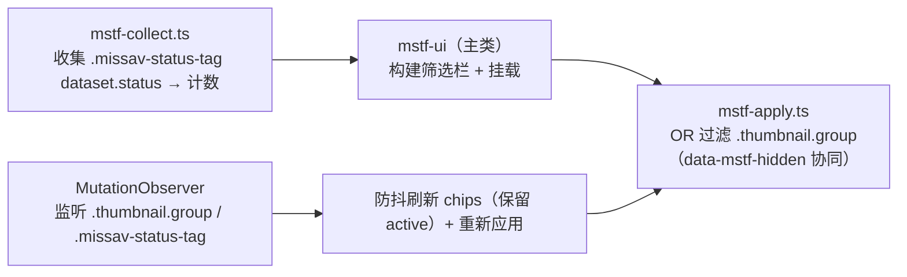

# MissAV 状态标签筛选实施计划

> **文档类型**：🔧 开发指导
> **文档状态**：✅ 已执行
> **版本**：1.42.0 → 1.43.0（新增功能插件，minor）
> **前置调研**：Camoufox 实测确认挂载点（doc/220 会话 + 本会话 probe9）
> **执行方式**：subagent-driven development（2 任务 + 1 审查回环修复，审查 Approved）

## 1. 背景与需求

用户要求给 missav 加状态标签筛选器，像 javdb 的 StatusTagFilterPlugin 一样：
在列表页通过「⭐ 已收藏 / 🔍 已观看 / 🚫 已屏蔽 / 💾 已下载 / 无状态标签」芯片筛选
瀑布流内容。

### 1.1 可行性要点（已验证）

- **数据源现成**：missav 缩略图上的 `.missav-status-tag` 标签已由 MissavStatusTagPlugin
  渲染（`dataset.status` = favorite/hasWatch/filter/hasDown），筛选器直接读 DOM 标签，
  零新数据源；
- **挂载点实测确认**（Camoufox probe9）：grid 正上方有 `DIV.flex.justify-between.mb-6`
  （原生"过滤: 所有"行），筛选栏插到其后，位置天然；
- **样式基础现成**：`filter-chip-base.css`（doc/180）已提取筛选栏+芯片共享基础
  （`.status-tag-filter-*` / `.jhs-vlt-filter-*` / `.preload-filter-*` 三前缀分组），
  扩展第四个前缀 `missav-status-filter-*` 即可，零重复实现；
- **协同**：标签渲染（MissavStatusTagPlugin）、瀑布流（MissavAutoPagePlugin）均通过
  MutationObserver 自动覆盖新缩略图，筛选器另挂 observer 刷新计数 + 重新应用即可。

### 1.2 协同安全（参考 doc/48 的 data-hide 语义）

missav 端无其他隐藏机制（标签插件只挂标签、瀑布流只追加），筛选器用独立
`data-mstf-hidden` 属性标记自己隐藏的卡片，与其他插件/原生渲染零冲突。

## 2. 方案

### 2.1 架构

新插件 `MissavStatusFilterPlugin`（`src/plugins/missav-status-filter/` 子目录）：



### 2.2 模块拆分

| 文件 | 职责 |
|------|------|
| `src/plugins/missav-status-filter/mstf-collect.ts` | 纯函数 + DOM 收集：`NO_TAG_VALUE` / `STATUS_ORDER` / `statusToLabel` / `getItemStatus` / `collectStatusCounts` |
| `src/plugins/missav-status-filter/mstf-apply.ts` | 过滤：`shouldShow`（纯函数）/ `applyFilter`（DOM） |
| `src/plugins/missav-status-filter/missav-status-filter-plugin.ts` | 主类：构建筛选栏、挂载、芯片交互、MutationObserver、生命周期 |
| `src/styles/missav-status-filter/missav-status-filter.css` | active 配色 + no-tag 变体（专属） |
| `tests/missav-status-filter.test.ts` | 纯函数回归测试（jsdom） |

### 2.3 关键设计

| 决策点 | 选择 |
|--------|------|
| 类名前缀 | `missav-status-filter-*`（bar/label/chips/chip），加入 filter-chip-base.css 分组选择器第四个前缀 |
| 芯片顺序 | 固定 `STATUS_ORDER = ['favorite','hasWatch','filter','hasDown']`（STATUS_CONFIG.label 显示）→ 最后「无状态标签」 |
| 过滤逻辑 | `shouldShow(status, active)`：active 空 → 全显示；否则 OR（命中任一状态显示）；隐藏卡片 `display:none` + `data-mstf-hidden="yes"`，显示卡片移除属性 |
| 挂载 | `DIV.flex.justify-between.mb-6` afterend；降级 `h1` 后；再降级 grid 前 |
| 刷新 | MutationObserver（childList + attributes:['data-status']）防抖 150ms → 重建 chips（保留 active）+ applyFilter |
| 协同 | 独立 `data-mstf-hidden` 属性；不触碰 `.missav-status-tag` 渲染、瀑布流追加、原生 Alpine |
| 生命周期 | TaskSupervisor（observer/防抖计时器） |

## 3. 任务分解

### Task 1：收集 + 过滤纯函数模块 + 测试

**文件**：
- Create：`src/plugins/missav-status-filter/mstf-collect.ts`
- Create：`src/plugins/missav-status-filter/mstf-apply.ts`
- Test：`tests/missav-status-filter.test.ts`

**Interfaces**（Task 2 依赖，签名精确）：
- `NO_TAG_VALUE = 'no-tag'`
- `STATUS_ORDER: string[]`（favorite/hasWatch/filter/hasDown）
- `statusToLabel(status: string): string`（STATUS_CONFIG.label，未知 status 原样返回）
- `getItemStatus(item: Element): string | null`（读 `.missav-status-tag` 的 `dataset.status`，无标签 null）
- `collectStatusCounts(): Record<string, number>`（遍历 `.thumbnail.group`，返回 显示名→计数；无标签记入 `NO_TAG_VALUE`）
- `shouldShow(itemStatus: string | null, activeValues: Set<string>): boolean`（active 空 → true；否则 `activeValues.has(itemStatus ?? NO_TAG_VALUE)`）
- `applyFilter(activeValues: Set<string>): void`（遍历 `.thumbnail.group`，调 shouldShow 显隐 + `data-mstf-hidden` 属性）

```ts
// mstf-collect.ts 关键实现
import { STATUS_CONFIG } from '../car-status-sync/car-status-config';

export const NO_TAG_VALUE = 'no-tag';
export const STATUS_ORDER = ['favorite', 'hasWatch', 'filter', 'hasDown'];

export function statusToLabel(status: string): string {
    return STATUS_CONFIG[status]?.label || status;
}

export function getItemStatus(item: Element): string | null {
    const tag = item.querySelector<HTMLElement>('.missav-status-tag');
    return tag?.dataset.status || null;
}

export function collectStatusCounts(): Record<string, number> {
    const counts: Record<string, number> = {};
    let noTag = 0;
    document.querySelectorAll('.thumbnail.group').forEach((item) => {
        const status = getItemStatus(item);
        if (status) {
            const name = statusToLabel(status);
            counts[name] = (counts[name] || 0) + 1;
        } else {
            noTag++;
        }
    });
    if (noTag > 0) counts[NO_TAG_VALUE] = noTag;
    return counts;
}
```

```ts
// mstf-apply.ts 关键实现
import { NO_TAG_VALUE } from './mstf-collect';

export function shouldShow(itemStatus: string | null, activeValues: Set<string>): boolean {
    if (activeValues.size === 0) return true;
    return activeValues.has(itemStatus ?? NO_TAG_VALUE);
}

export function applyFilter(activeValues: Set<string>): void {
    document.querySelectorAll<HTMLElement>('.thumbnail.group').forEach((item) => {
        const tag = item.querySelector<HTMLElement>('.missav-status-tag');
        const status = tag?.dataset.status ?? null;
        if (shouldShow(status, activeValues)) {
            item.style.display = '';
            item.removeAttribute('data-mstf-hidden');
        } else {
            item.style.display = 'none';
            item.setAttribute('data-mstf-hidden', 'yes');
        }
    });
}
```

- [ ] **Step 1：写失败测试**（`tests/missav-status-filter.test.ts`，首行 `// @vitest-environment jsdom`）
  - shouldShow：空 active 全 true / 命中 / 未命中 / 无标签状态（NO_TAG_VALUE）
  - statusToLabel：favorite→'⭐ 已收藏' / 未知原样
  - getItemStatus：有 dataset.status / 无标签 null
  - collectStatusCounts：混合计数 / 无标签计入 NO_TAG_VALUE / 空页面 {}（jsdom 构造 HTML）
  - applyFilter：OR 显隐 + data-mstf-hidden 属性（jsdom 构造 .thumbnail.group + .missav-status-tag）
- [ ] **Step 2：运行确认失败** → 实现两模块 → 测试通过
- [ ] **Step 3：全量验证**：`bun run build` / `lint` / `test` / `check:structure`
- [ ] **Step 4：提交**：`git commit -m "新增 MissAV 状态筛选纯函数模块"`

### Task 2：插件主类 + 样式 + 注册

**文件**：
- Create：`src/plugins/missav-status-filter/missav-status-filter-plugin.ts`
- Create：`src/styles/missav-status-filter/missav-status-filter.css`
- Modify：`src/styles/filter-chip-base.css`（分组选择器加第四个前缀 `missav-status-filter-*`）
- Modify：`src/main.tsx`（isMissavSite 块注册）
- Modify：`src/plugins/plugin-registry.ts`（PluginMap 映射）

**接口**：
- 主类 `getName()` → `'MissavStatusFilterPlugin'`
- `initCss()` → `missavStatusFilterCssRaw`（专属 CSS；基础样式由 filter-chip-base.css 顶层注入）
- `handle()`：非视频页（isVideoPage 守卫）→ 构建筛选栏 + 挂载 + MutationObserver
- 方法：`tryBuild()` / `buildFilterBar(mountTarget)` / `refreshChips()`（保留 active）/ `applyFilter` 委托 / `startObserving()`（防抖 150ms）
- 字段：`supervisor = new TaskSupervisor()`、`observerDebounce`、`filterBar` 引用

主类关键实现：

```ts
// missav-status-filter-plugin.ts 核心
import { TaskSupervisor } from '../../core/task-supervisor';
import { BasePlugin } from '../base-plugin';
import { isVideoPage } from '../car-status-sync/missav-renderer';
import { NO_TAG_VALUE, STATUS_ORDER, collectStatusCounts, statusToLabel } from './mstf-collect';
import { applyFilter } from './mstf-apply';

import missavStatusFilterCssRaw from '../../styles/missav-status-filter/missav-status-filter.css?raw';

/** 挂载点：grid 上方的原生「过滤: 所有」行（Camoufox 实测）。 */
const MOUNT_SELECTOR = 'div.flex.justify-between.mb-6';

export class MissavStatusFilterPlugin extends BasePlugin {
    private supervisor = new TaskSupervisor();
    private observerDebounce = 0;
    private filterBar: HTMLDivElement | null = null;

    getName(): string { return 'MissavStatusFilterPlugin'; }

    async initCss(): Promise<string> { return missavStatusFilterCssRaw; }

    async handle(): Promise<void> {
        if (isVideoPage()) return;
        this.tryBuild();
        this.startObserving();
    }

    private tryBuild(): boolean {
        if (document.querySelector('.missav-status-filter-bar')) return true;
        const mount = document.querySelector(MOUNT_SELECTOR)
            ?? document.querySelector('h1')
            ?? document.querySelector('.thumbnail.group')?.parentElement?.parentElement;
        if (!mount) return false;
        this.buildFilterBar(mount);
        return true;
    }

    private buildFilterBar(mount: Element): void {
        const bar = document.createElement('div');
        bar.className = 'missav-status-filter-bar';
        const label = document.createElement('span');
        label.className = 'missav-status-filter-label';
        label.textContent = '状态:';
        const chips = document.createElement('div');
        chips.className = 'missav-status-filter-chips';
        bar.append(label, chips);
        mount.insertAdjacentElement('afterend', bar);
        this.filterBar = bar;
        this.renderChips(chips);
        // 芯片点击 → 重应用
        chips.addEventListener('click', (e) => {
            const chip = (e.target as HTMLElement).closest?.('.missav-status-filter-chip');
            if (chip) {
                chip.classList.toggle('active');
                this.applyActiveFilter();
            }
        });
    }

    private renderChips(chips: HTMLDivElement): void {
        const active = new Set(
            Array.from(chips.querySelectorAll('.missav-status-filter-chip.active')).map(
                (c) => (c as HTMLElement).dataset.value || ''
            )
        );
        chips.innerHTML = '';
        const counts = collectStatusCounts();
        const ordered = [...STATUS_ORDER.map(statusToLabel), ...(counts[NO_TAG_VALUE] ? [NO_TAG_VALUE] : [])];
        for (const name of ordered) {
            const c = counts[name] ?? 0;
            if (c === 0) continue;
            const chip = document.createElement('span');
            chip.className = 'missav-status-filter-chip';
            if (name === NO_TAG_VALUE) chip.classList.add('no-status');
            chip.textContent = name === NO_TAG_VALUE ? `无状态标签 ${c}` : `${name} ${c}`;
            chip.dataset.value = name;
            if (active.has(name)) chip.classList.add('active');
            chips.appendChild(chip);
        }
    }

    private applyActiveFilter(): void {
        if (!this.filterBar) return;
        const chips = this.filterBar.querySelector('.missav-status-filter-chips');
        const active = new Set(
            Array.from(chips?.querySelectorAll('.missav-status-filter-chip.active') ?? []).map(
                (c) => (c as HTMLElement).dataset.value || ''
            )
        );
        applyFilter(active);
    }

    private startObserving(): void {
        this.supervisor.observe(document.body, () => {
            clearTimeout(this.observerDebounce);
            this.observerDebounce = this.supervisor.setTimeout(() => {
                if (!this.filterBar) return;
                const chips = this.filterBar.querySelector('.missav-status-filter-chips');
                if (chips) {
                    const active = new Set(
                        Array.from(chips.querySelectorAll('.missav-status-filter-chip.active')).map(
                            (c) => (c as HTMLElement).dataset.value || ''
                        )
                    );
                    this.renderChips(chips as HTMLDivElement);
                    applyFilter(active);
                }
            }, 150);
        }, { childList: true, subtree: true, attributes: true, attributeFilter: ['data-status'] });
    }

    destroy(): void { this.supervisor.abort(); }
}
```

注意：renderChips 重建后 active 保留（renderChips 内部读取并存回）。observer 里先取 active 再 renderChips + applyFilter。buildFilterBar 的 click 委托在 chips 容器上（重建后仍有效）。

- [ ] **Step 1：实现主类 + CSS + filter-chip-base.css 扩展 + 注册**
- [ ] **Step 2：验证**：`bun run build` / `lint` / `test` / `check:structure`
- [ ] **Step 3：提交**：`git commit -m "新增 MissAV 状态标签筛选插件"`

### Task 3：收尾（版本号 + 文档 + changelog + 计数）

- [ ] **Step 1**：`vite.config.ts` version `1.42.0 → 1.43.0`（新增插件，minor）
- [ ] **Step 2**：本文档状态 → ✅ + 填写执行验证记录
- [ ] **Step 3**：`doc/README.md` 文档清单 + 阅读顺序 + 进度概览
- [ ] **Step 4**：`changelog/CHANGELOG.md` 新增 v1.43.0
- [ ] **Step 5**：`AGENTS.md` §1/§2/§3.1/§3.3 插件计数 42→43（javdb 39 + missav 4）+ 新插件行 + §2 styles 子目录
- [ ] **Step 6**：`bun run build` 确认产物 `@version 1.43.0`；提交

## 4. 验证方案

- 纯函数：`tests/missav-status-filter.test.ts`（jsdom，~10 用例：shouldShow / statusToLabel / getItemStatus / collectStatusCounts / applyFilter）
- 静态：`tsc -b` / `lint`(0/0) / `check:structure`（styles 直接文件数保持 38，新 CSS 入子目录）
- **浏览器实测（用户或 Camoufox）**：chip 点击过滤 / 计数正确 / 与瀑布流新缩略图协同 / 与标签渲染协同

## 5. 评估与风险

- **标签渲染时序**：跨站同步消费后 MissavStatusTagPlugin 才渲染标签，筛选器 observer 监听
  `data-status` 属性变化自动刷新——最终一致；
- **瀑布流**：追加新缩略图 → observer childList 触发 → 刷新 chips + 重应用筛选；
- **无状态标签**：跨站同步未覆盖的番号显示「无状态标签」芯片；
- **不变量**：不触碰 `data-mstf-hidden` 之外的 DOM 属性；不修改标签渲染/瀑布流/跨站同步。

## 6. 后续可扩展（不纳入本期）

- 屏蔽/黑名单过滤（按关键词/黑名单隐藏 missav 内容）；
- 筛选状态持久化（localStorage 记住已选芯片）。

## 7. 执行验证记录

### 执行环境

Windows + Bun + Chrome（构建/静态验证）。

### 验证命令

```text
$ bun run build          # = tsc -b && vite build
$ bun run lint           # eslint src/
$ bun run test           # vitest run
$ bun run check:structure
```

### 实际输出

```text
$ bun run build
✓ 407 modules transformed.
[lightningcss minify] …（layer.css IE hack 警告，已知无害项）
dist/monkey-jhs-disassemble.user.js  … kB │ gzip: … kB
✓ built in ~1.4s
产物头部 @version 1.43.0（已核对）

$ bun run lint
（无输出 = 0 errors / 0 warnings）

$ bun run test
 Test Files  11 passed (11)
      Tests  161 passed (161)   ← 含 mstf 纯函数 14 + 接线 1 用例

$ bun run check:structure
check-structure: OK (364 files, 62 dirs within limits)
```

### 审查回环（关键发现与修复）

subagent 审查发现 3 项并已修复（复审 Approved）：

| 级别 | 问题 | 修复 |
|------|------|------|
| Critical | `renderChips` 的 `chip.dataset.value` 存显示 label（'⭐ 已收藏'），而 `applyFilter` 按原始 `dataset.status` key（'favorite'）匹配 → 点击芯片会把全部卡片隐藏 | 遍历 `STATUS_ORDER` 原始 key，`dataset.value = status`（文本仍显示 label）；+接线测试 `missav-status-filter-ui.test.ts` |
| Important | observer 无门控，renderChips 重建触发自身 → 每 150ms 一次死循环 | `observerNeedsRefresh` 门控：仅 `.thumbnail.group`/`.missav-status-tag` 新增/删除或 `data-status` 属性变更才刷新 |
| Minor | `tryBuild()` 失败无重试（挂载点迟到时筛选栏永不出现） | observer 回调门控通过后先 `tryBuild()`；removedNodes 检查补充 |

### 前端或调用方验证

- 挂载点 `div.flex.justify-between.mb-6`（Camoufox probe9 实测 grid 上方「过滤: 所有」行）→ afterend 插入筛选栏；降级 `h1` 后 / grid 父链；
- 与瀑布流（MissavAutoPagePlugin 追加新缩略图）/ 标签渲染（MissavStatusTagPlugin 跨站同步消费后渲染）协同：observer 门控覆盖新增/删除/`data-status` 变更，自动刷新计数并重应用筛选；
- 与 javdb 版 StatusTagFilterPlugin 的差异：javdb 用文本匹配（value=标签文本），missav 用属性匹配（dataset.status 原始 key）——审查回环发现并修正了这个移植差异。

### 验证结论

✅ 通过。两个任务 + 审查回环修复全部 Approved；构建/lint/161 测试/结构门禁全绿；产物 `@version 1.43.0`。

### 已知限制（需用户浏览器实测）

1. **筛选栏交互**：需在真实 Tampermonkey 环境确认芯片计数正确、点击 OR 过滤、与瀑布流新缩略图协同；
2. **挂载视觉**：筛选栏插入「过滤: 所有」行后的布局需目视确认（无挤压/错位）；
3. **无状态标签**：跨站同步尚未覆盖的番号计入「无状态标签」芯片。