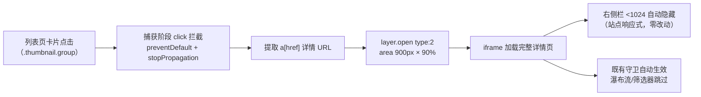

# MissAV 视频流 iframe 详情弹窗实施计划

> **文档类型**：🔧 开发指导
> **文档状态**：🔧 待执行
> **版本**：1.43.5 → 1.44.0（新增功能插件，minor）
> **前置调研**：Camoufox 真实浏览器实测（本会话，探针脚本 `.superpowers/camoufox-missav/`）
> **执行方式**：subagent-driven development（计划 3 任务，逐任务审查）
> **交互确认**：用户已确认 ①左键弹窗/修饰键新标签 ②顶部条不隐藏 ③尺寸 min(900px, 视口-40)×90%

## 1. 背景与需求

用户希望 missav 列表页（视频流）支持 **javdb 同款交互**：点击视频卡片弹出
**iframe 界面**加载视频详情页，突出显示左侧主内容区（播放器 + 标题 + 工具
栏），而无需跳转新页面。用户实测确认：**missav 在 1024px 宽度以下（不含
1024）会自动隐藏右侧推荐栏**，因此 iframe 宽度设 <1024 即可自然突出左侧，
无需额外隐藏逻辑。

### 1.1 Camoufox 实测证据（已验证事实）

用 Camoufox（反检测 Firefox，经 `uv run --with camoufox` 驱动）绕过 Cloudflare
访问 missav 实测（探针 `probe-preview.py` / `probe-click.py` / `probe-top.py`）：

| 探测项 | 实测结果 | 结论 |
|--------|----------|------|
| 响应式右侧栏 | 视口 900/1023px 右侧栏 `display:none`（左侧 736px 占满）；1024/1200px 右侧 `display:flex`（300px，左侧 668px） | **<1024 自动隐藏右侧，用户说法完全正确** |
| iframe 加载详情页 | 列表页内嵌 900px 宽 iframe 加载 `/cn/mkmp-745` → 右侧自动隐藏、左侧 736px 占满、`#sprite-plyr` 播放器正常加载、标题正确 | **iframe 方案成立，无需特殊隐藏逻辑** |
| 卡片点击结构 | `.thumbnail.group` 带 Alpine `@click="clickPreview('<uuid>')"` + 内部 `a[href]`（详情页链接，2 个封面链接 + 1 个标题链接） | 拦截点明确 |
| 站点原生点击 | 点击卡片触发 `clickPreview`（Alpine），页面出现一个空 iframe（站点预览容器），**不跳转** | 拦截后需阻止 Alpine 冒泡，避免站点预览弹层 |
| 拦截可行性 | 捕获阶段 `document.addEventListener('click', ..., true)` + `preventDefault()` + `stopPropagation()` → 点击 `a[href]` 后 `location.href` 不变 | **capture 拦截 + 阻止传播方案可行**（Alpine 委托监听在 document，捕获阶段 stopPropagation 可阻断） |
| 详情页顶部 | 900px 视口：顶部条 56px 显示（用户确认**不隐藏**）；内容区 `padding-top: 80px` 为站点自身布局 | 不做任何 CSS 注入，iframe 内即完整详情页 |

### 1.2 与现有插件的协同

- **MissavAutoPagePlugin / MissavStatusFilterPlugin**：`isVideoDetailPath` 守卫
  （doc/227）在 iframe 视频页内自动跳过瀑布流/筛选器——**零改动**；
- **MissavQuickCopyPlugin**：iframe 视频页内正常插入「复制番号/转JavDB」按钮
  （弹窗内可用）——**零改动，预期行为**；
- **MissavStatusTagPlugin**：视频页无缩略图网格，observer 无目标——**零改动**；
- **MissavVideoPreviewPlugin（新）**：iframe 内视频页底部有推荐区（同款
  `.thumbnail.group` grid，doc/220 实测），点击推荐缩略图同样弹新窗（嵌套
  layer，与 javdb iframe 内行为一致）。

### 1.3 与 javdb openPage 机制对齐

javdb 的 `utils.openPage`（`src/core/common-util.ts` L132-157）：
`layer.open({ type: 2, content: url, area: getResponsiveArea(['85%','90%']) })`，
javdb 详情页用 `?hideNav=1` 隐藏导航。**missav 无需任何 URL 参数/CSS 注入**：
iframe 宽度 900px < 1024px 自动隐藏右侧推荐栏，顶部条保留（用户确认），
iframe 内即完整详情页。仅复用 `layer.open({ type: 2 })` iframe 弹窗机制。

## 2. 方案

### 2.1 架构



### 2.2 模块拆分

`src/plugins/missav-video-preview/` 子目录（参考 missav-auto-page/ 先例）：

| 文件 | 职责 |
|------|------|
| `mv-selectors.ts` | 选择器常量 + 纯函数（findDetailUrl / isPlainLeftClick / CARD_SEL） |
| `missav-video-preview-plugin.ts` | 插件主类：文档级捕获 click 拦截 + layer.open 弹窗 |

### 2.3 关键设计决策

| 决策点 | 选择 | 理由 |
|--------|------|------|
| 拦截方式 | `document` 捕获阶段 click 监听（`{ capture: true }`）+ `target.closest(CARD_SEL)` 命中 → `preventDefault` + `stopPropagation` | 实测可行；捕获阶段 stopPropagation 阻断 Alpine document 委托（clickPreview 不触发） |
| 触发按键 | 左键（`e.button === 0`）且非 Ctrl/Cmd/Shift/Alt 修饰键 → 弹窗；中键/右键/Ctrl+点击 → 保留原生行为（新标签） | 对齐 javdb openPage 语义（ctrl/meta 新标签） |
| 弹窗 | `layer.open({ type: 2, content: url, area: [\`min(900, vw-40)px\`, '90%'], scrollbar: false })` | 900px < 1024 右侧自动隐藏；layer-wrapper 已提供 ESC/closeBtn 基建 |
| iframe 内处理 | **无 URL 参数、无 CSS 注入**；iframe 内即完整详情页（顶部条保留，用户确认） | 用户明确「顶部条不需要隐藏」；右侧栏由站点响应式自动隐藏 |
| 推荐区嵌套 | iframe 视频页内点击底部推荐缩略图 → iframe 内 layer 弹窗 | 与 javdb iframe 行为一致；layer 在 iframe 文档内层叠 |
| 生命周期 | `TaskSupervisor` 管理捕获监听器 | 项目统一约定（doc/139） |
| 守卫 | 列表页全站注册（无 pageTypes 覆写）；iframe 视频页推荐区仍可弹窗（无需拦截守卫） | 与 missav-auto-page 同模式 |
| 设置项 | 本期不做（默认开启） | YAGNI，用户未要求开关 |
| 样式 | 无独立 CSS 文件、无 initCss | 纯 DOM 拦截 + 既有 layer 基础设施，零样式 |

**弹窗尺寸计算**：`min(900, vw - 40)` 用 `getResponsiveArea(['85%','90%'])`
不适用（85% 在宽屏可能 >1024 触发右侧栏显示）；改为显式 `area: [(Math.min(900, window.innerWidth - 40)) + 'px', '90%']`。

### 2.4 交互细节（用户已确认）

1. **点击范围**：所有列表页卡片**左键点击 → 弹窗**；中键/右键/Ctrl+点击
   保留原生行为（新标签打开详情页）——✅ 用户确认；
2. **弹窗内容**：加载**完整详情页**（播放器/收藏/片单/下载/分享/复制番号/转
   JavDB 全部可用），**顶部条不隐藏**——✅ 用户确认；
3. **弹窗尺寸**：`min(900px, 视口宽-40px)` × 90% 高——✅ 用户确认。

## 3. 任务分解

### Task 1：纯函数模块 + 测试（mv-selectors.ts）

**文件**：
- Create：`src/plugins/missav-video-preview/mv-selectors.ts`
- Test：`tests/missav-video-preview.test.ts`

**Interfaces**：
- `CARD_SEL = '.thumbnail.group'` — 卡片选择器（与 MAP_SEL.thumb 一致）
- `findDetailUrl(card: Element): string | null` — 从卡片内 `a[href]` 取详情绝对 URL
  （querySelector 首个 `a[href]`，返回 `.href` 绝对 URL）
- `isPlainLeftClick(e: MouseEvent): boolean` — `e.button === 0 && !e.ctrlKey &&
  !e.metaKey && !e.shiftKey && !e.altKey`

```ts
// mv-selectors.ts 关键实现（Task 1 交付）
export const CARD_SEL = '.thumbnail.group';

export function findDetailUrl(card: Element): string | null {
    const a = card.querySelector<HTMLAnchorElement>('a[href]');
    return a ? a.href : null;
}

export function isPlainLeftClick(e: MouseEvent): boolean {
    return e.button === 0 && !e.ctrlKey && !e.metaKey && !e.shiftKey && !e.altKey;
}
```

- [ ] **Step 1：写失败测试**（tests/missav-video-preview.test.ts，node 环境，
      HTML 片段 + DOMParser + 构造 MouseEvent）
- [ ] **Step 2：运行测试确认失败**：`bun run test tests/missav-video-preview.test.ts`
- [ ] **Step 3：实现 mv-selectors.ts**
- [ ] **Step 4：测试通过**
- [ ] **Step 5：提交**：`git commit -m "新增 MissAV 视频预览纯函数模块"`

### Task 2：插件主类 + 注册

**文件**：
- Create：`src/plugins/missav-video-preview/missav-video-preview-plugin.ts`
- Modify：`src/main.tsx`（isMissavSite 块注册）
- Modify：`src/plugins/plugin-registry.ts`（PluginMap 类型映射）

**Interfaces**：
- 主类 `handle()`：
  1. 注册捕获阶段 click 监听（TaskSupervisor 管理）：
     `e.target.closest(CARD_SEL)` 命中 + `isPlainLeftClick(e)` →
     `findDetailUrl(card)` → 非空时 `e.preventDefault()` + `e.stopPropagation()`
     → `layer.open({ type: 2, content: url, area: [width, '90%'], scrollbar: false })`
  2. `width = Math.min(900, window.innerWidth - 40)` 像素字符串
- 弹窗 URL 为完整详情页 URL（不加任何参数，顶部条保留）

```ts
// 主类 handle() 核心（Task 2 交付）
async handle(): Promise<void> {
    this.supervisor.addEventListener(document, 'click', (e: MouseEvent) => {
        const target = e.target as Element | null;
        const card = target?.closest<HTMLElement>(CARD_SEL);
        if (!card || !isPlainLeftClick(e)) return;
        const url = findDetailUrl(card);
        if (!url) return;
        e.preventDefault();
        e.stopPropagation();
        const width = Math.min(900, window.innerWidth - 40);
        layer.open({
            type: 2,
            content: url,
            scrollbar: false,
            area: [`${width}px`, '90%']
        });
    }, { capture: true });
}
```

- [ ] **Step 1：实现 missav-video-preview-plugin.ts**
- [ ] **Step 2：main.tsx 注册**（isMissavSite 块 + plugin-registry.ts 映射）
- [ ] **Step 3：验证**：`bun run build && bun run lint && bun run test && bun run check:structure`
- [ ] **Step 4：提交**：`git commit -m "新增 MissAV 视频流 iframe 详情弹窗插件"`

### Task 3：收尾（版本号 + 文档 + changelog）

- [ ] **Step 1**：`vite.config.ts` version `1.43.5 → 1.44.0`（新增插件，minor）
- [ ] **Step 2**：本文档状态 → ✅ + 填写执行验证记录
- [ ] **Step 3**：`doc/README.md` 文档清单 + 阅读顺序 + 进度概览更新
- [ ] **Step 4**：`changelog/CHANGELOG.md` 新增 v1.44.0
- [ ] **Step 5**：`bun run build` 确认产物 `@version 1.44.0`；提交

## 4. 验证方案

- 纯函数：`tests/missav-video-preview.test.ts`（node 环境，~8 用例）
- 静态：`tsc -b` / `lint`(0/0) / `check:structure`
- **浏览器实测（Camoufox 回归）**：
  1. missav 列表页左键点击卡片 → 900px iframe 弹窗，右侧自动隐藏、左侧占满、
     Plyr 播放器加载、顶部条保留、复制番号按钮可用
  2. 中键/右键/Ctrl+点击 → 新标签打开（原生行为）
  3. 弹窗内点击底部推荐缩略图 → 嵌套弹窗
  4. 关闭弹窗后列表页滚动/瀑布流/筛选器正常

## 5. 评估与风险

- **Alpine 预览冲突**：捕获阶段 stopPropagation 阻断 clickPreview（实测验证）；
  若 Alpine 在捕获阶段另有 document 级监听（未实测到），兜底在卡片上直接挂
  click 监听；
- **iframe 内脚本执行**：userscript 在 iframe 文档内完整运行（无 @noframes），
  各插件守卫已验证（doc/227）；
- **layer 嵌套**：iframe 内 layer.open 在 iframe 文档内层叠（javdb 同行为），
  关闭后 shade 计数恢复（layer-wrapper 已处理）；
- **随机前缀域**：详情 URL 从卡片 `a[href]` 提取（绝对 URL 含随机前缀），
  不自行拼接；
- **不变量**：不触碰状态标签渲染、跨站同步、瀑布流/筛选器逻辑；新插件独立
  注册 isMissavSite 块。

## 6. 后续可扩展（不纳入本期）

- 设置项（弹窗开关 / 宽高比）；
- javdb 列表页点击卡片也改弹窗（现有 dialogOpenDetail 设置已支持，无需改）。