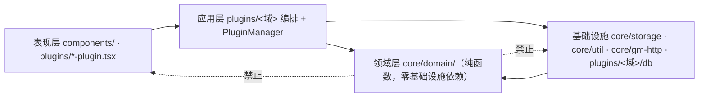

# 46 - 领域驱动重构（试点：番号身份共享内核）

- **状态**：已执行
- **影响范围**：`src/core/domain/`（新增领域层）、`src/core/storage/`、`src/plugins/{base-plugin,car-status-sync,rating-display,missav-auto-page,status-tag-filter-plugin}`、`tests/`、`scripts/check-structure.ts`、`AGENTS.md`、`docs/plugin-catalog.md`
- **前置文档**：doc/01（拆分与组件化）、doc/07（架构与工具化）、doc/09（复用与跨站同步）、doc/42（版本卫生）
- **生效版本**：v1.47.6

本文件同时是**领域重构的现状分析、目标架构、试点实施与后续路线**记录。试点已实施完毕，路线部分为未完成迁移清单。

---

## 一、现状分析（实测证据）

### 1.1 方法与事实基线

- 依赖图：对 `src/**` 全部 386 个 `.ts/.tsx` 做静态解析（相对路径/别名解析 + Tarjan SCC），得到组粒度边与环。
- 领域盘点：按 `plugins/<组>` 与 `components/<组>` 逐文件核对业务目的、真实业务名词、归属存储、外部集成。
- 规则盘点：逐条定位业务规则、不变量、状态机、失败处理，并标出与 DOM/IndexedDB/HTTP 混层的函数。
- 巨型文件：对 20 个最大文件诊职责混杂与巨函数。

### 1.2 结构性问题（四条主线）

**① 环依赖 6 处，其中 1 处 95 文件巨型 SCC —— 但全部是类型层环**

| SCC | 文件数 | 成因 | 运行期风险 |
|-----|-------|------|-----------|
| plugin-registry ↔ 各插件 ↔ base-plugin | 95 | `plugin-registry.ts` 用 44 条 `import type` 拉入全部插件类；`base-plugin.ts:32-33` 又反向 `import type` 注册表/管理器，而插件类**值**依赖 base-plugin → 闭合 | 无（rollup 擦除类型边后为 DAG） |
| `core/storage/*` + `storage-manager` | 7 | `storage-manager` 委托 ops，ops 又 import `storage-manager` 类型 | 无（同为类型边） |
| `plugins/video-lists-tag`（服务端/筛选两簇） | 3 / 5 | `vlt-server.ts:21 ↔ vlt-checkbox.ts:24` 是**唯一真值循环**；另一簇为渲染/筛选工具互引 | 当前无顶层跨模块求值，不炸 |

**② 跨模块越界（比环更实际的问题）**

- 18 条「插件 A 直接 import 插件 B 内部实现」（如 `detail-page-button/dpb-list-merge-ui.ts` 一次性 import `video-lists-tag` 四个内部模块；`setting/cache-management.ts` import `rating-display/rating-cache`）。历史故障证据：`vlt-checkbox.ts:137-142` 因拿不到插件实例而退化为点击 `.jhs-fav-btn` 原生按钮。
- 4 条 `core` → `plugins` 反向依赖（1 条是值依赖：`components/other-site/preload-queue-panel.tsx` → `plugins/other-site/osp-preload-tasks`）。
- 共享可变状态多处权威：GM `jhs_car_status_data` 有两个写者且 payload 结构不同（`car-list-reader-plugin.ts:283-291` 带 `revision/mode/ready`，`setting/data-import-export.ts:239-256` 只有 `ts`）；页面类型存在 `pageContext` 单例与 `window.isXxx` 双权威；`window.clog` 跨 frame 双实例。

**③ 同一条领域规则多处实现（番号身份最严重）**

| 口径 | 实现位置（重构前） |
|------|------------------|
| `trim + 大写` | `external-visit-ops.ts:61`、`car-status-columnar.ts:349`、`car-status-db.ts:230/464/558`、`car-status-journal.ts:86` |
| `trim + 大写 + 空白转连字符` | `rating-utils.ts:116 normalizeCode` |
| MissAV 页面形态（末段/FC2-PPV/前两段） | `missav-renderer.ts:23 normalizeCarNum` |
| 页面原文**不归一**、靠大小写不敏感比较 | `car-list-ops.ts` 5 处（跟随 `caseInsensitiveCarNum`）+ 3 处**不跟随**（`updateCarInfo` / `removeCar` / `batchRemoveCars`，精确匹配） |

其他重复：`getSeries/getCode` 两份（`vlt-helpers.ts` 与 `vlt-reconcile.ts`）；状态→标签/颜色两份（`car-status-config.ts` STATUS_CONFIG 与 `constants/status.ts` + `util-status-tag.tsx`）；CSRF 读取三份；视频页判定两份；FC2 前缀剥离三套语义（`/^FC2-/`、`/^FC2-?(PPV-?)?/i`、`'FC2-'`）；外站缓存键白名单三处并列维护。

**④ 巨型文件与混层热点**

单文件最大 897 行（`styles`），TS 最大 639 行（`car-status-db.ts`，18 函数：IDB 事务 + 记录/URL 校验 + 修订号门控 + 快照对账回滚）；`missav-status-tag-plugin.handle()` 单函数 174 行、`lr-panel.initReflowPanel()` 305 行、`vlt-create-list-api.createList()` 205 行。混层热点示例：`vlt-reconcile.runAutomaticReconciliation()`（DOM checkbox + IDB + HTTP 分页写回）、`lp-filter.filterMovieList()`（IDB 读 + DOM 显隐 + 翻译）、`data-import-export.importData()`（FileReader + 解密 + confirm + IDB + localStorage/GM + reload）。

### 1.3 领域闭环（识别出的真实业务能力）

| 能力 | 权威数据 | 关键规则位置 | 真实规则 or 薄 UI |
|------|---------|-------------|------------------|
| 影片状态 car_list | IDB `JAV-JHS/appData`（唯一写入口 `core/storage/car-list-ops.ts`） | 必填校验、actionType 白名单、重复状态拦截 | 真实规则 |
| 清单-番号关联 | JavDB 服务端为最终权威，本地 `vlt-db-core` 镜像 | 501 上限、`designation::listId` 关联键、count 重算、单事务、CAS 对账守卫、两遍抓取防穿插 | 真实规则（最完整的域） |
| 番号状态跨站投递 | GM `jhs_car_status_*` ↔ MissAV IDB 镜像 | 状态枚举白名单、链接白名单、修订号单调门控、增量压缩阈值 | 真实规则 |
| 个人评分 | `car_list.score` / `RatingCache`（localStorage + 寄生 IDB） | 解析判定（标记 + 选中值 1–5）、**只补空缺**落库、缓存双写合并 | 真实规则 |
| 列表过滤与读状态 | car_list + 黑名单 + 关键词 | 隐藏判定矩阵、状态标签优先级、协同安全属性 | 真实规则 |
| 设置/备份/同步 | localforage `settings` + GM 凭据存储 | payload 构造、加密分支、凭据校验、自动备份策略、JHS↔JavDB 四方向同步（拉取方向不写 score） | 真实规则 |
| 外部站点导航与计数 | 持久数据 namespace `externalVisit` | 真实外跳口径、点击时计数 | 真实规则（薄） |
| 其余 13 个纯 DOM 增强插件 | 无自有数据 | 无 | 薄 UI 适配 |

---

## 二、目标架构

### 2.1 分层与依赖方向（本次确立，试点已落地左列）

- **领域层**（新增 `src/core/domain/`）：跨上下文共享的业务概念与规则，纯函数、无 IO。每个概念一个文件，单点权威。
- **应用层**（沿用）：`*-plugin.tsx` 生命周期编排 + 各域 `vlt-*` / `dpb-*` / `car-status-*` 的用例函数。
- **基础设施层**（沿用）：`core/storage*`（localforage/IDB/GM）、`core/util`（站点选择器、广播、fetch）、`core/gm-http`。
- **表现层**（沿用）：`components/**`（React → `jsxToString` 字符串）、`*-renderer`、插件壳。

### 2.2 关键架构决策

1. **不整体迁移到 `src/domains/**`**。项目已有一套经门禁约束的既有约定（`core/ /plugins/ /components/ /styles/ /constants/ /types/`，`plugins/<域>` 本身就是「按业务域组织」）。整体搬迁会同时破坏 `check:structure` 棘轮、`check:docs` 的核心文件清单、`AGENTS.md` 计数与 386 个文件的引用路径，收益却只是目录形似 DDD。**按业务语义划定边界，而不是照抄目录模板**；领域层以 `core/domain/` 承担，各域在既有目录内按 `db/(rules)/ui` 收拢。
2. **共享内核只放真正跨上下文的规则**：番号身份、状态枚举、站点身份。域内私有规则留在域内，不上升为全局。
3. **不强行合并语义不同的模型**：MissAV 徽章文案与 JavDB 状态标签是两套展示模型，保留两份，但把**枚举**收敛为单源（见路线）。
4. **行为不变优先**：试点所有迁移以「逐字等价」为验收标准，发现的既有不一致（精确匹配 vs 大小写不敏感）**记录不改**，避免以重构之名改业务。

---

## 三、试点实施：视频身份共享内核

### 3.1 新增领域模块 `src/core/domain/car-num.ts`

| API | 语义 | 取代的旧实现 |
|-----|------|-------------|
| `normalizeCarNum(raw, 'upper')` | 存储键口径：trim + 大写 | 6 处（外站计数、列存去重、状态镜像 ×3、增量日志压缩） |
| `normalizeCarNum(raw, 'rating')` | 评分域口径：trim + 大写 + 空白转连字符 | `rating-utils.normalizeCode` |
| `normalizeCarNum(raw, 'path')` | MissAV 页面形态口径 | `missav-renderer.normalizeCarNum` |
| `carNumKey(raw, caseInsensitive)` / `carNumEquals(a, b, caseInsensitive)` | 匹配键与等价判定（大小写口径由调用方显式传入） | `car-list-ops` 5 处内联三元表达式 |
| `formatWesternCarNum(carNum, rawDate)` | 西方番号格式化业务规则 | `BasePlugin._formatWesternCar`（从插件基类下沉） |

策略以**具名参数**表达不同业务口径，避免「一套实现硬统一三种语义」；同时在调用点显式写出大小写口径，使既有差异可见。

### 3.2 迁移映射

| 旧位置 | 新引用 | 语义变化 |
|--------|--------|---------|
| `base-plugin.ts` `_formatWesternCar` | `formatWesternCarNum` | 无（方法删除） |
| `external-visit-ops.ts` `normalizeVisitCarNum`（导出） | `normalizeCarNum(x,'upper')` | 无（导出删除；仓内无外部使用者） |
| `car-status-db.ts` ×3 | `normalizeCarNum(x,'upper')` | 无 |
| `car-status-columnar.ts:349` | 同上 | 无（入参已 trim） |
| `car-status-journal.ts:86` | 同上 | 无 |
| `missav-renderer.ts` `normalizeCarNum`（导出） | `normalizeCarNum(x,'path')` | 无（导出删除，3 个调用方改引用领域层） |
| `rating-utils.ts` `normalizeCode`（经 `RatingUtils` 导出） | `normalizeCarNum(x,'rating')` | 无（导出项删除，5 个调用方改引用领域层） |
| `car-list-ops.ts` 5 处大小写三元 | `carNumEquals/carNumKey` | 无 |
| `car-list-ops.ts` 3 处精确匹配 | `carNumEquals(...,false)` + 注释 | 无（**口径差异保留并标注**） |
| `missav-auto-page/map-selectors.ts` | 直接引用领域层 | 无；顺带消除 1 条跨插件内部 import |

### 3.3 附带修正

- `scripts/check-structure.ts`：四条过期 `FILE_CEILINGS`（setting-plugin 1568 / storage-manager 1324 / vlt-tags 1028 / list-page-plugin 846）实际行数已分别是 500 / 421 / 421 / 283，按该文件自身规则整项删除；`DIR_CEILINGS` 收紧 `src/styles` 38→37、`src/core` 28→26。棘轮**只降不升**，本次为下调。
- `feature-flags.ts` 注释指向新权威。

---

## 四、实施（改动文件清单）

新增：

- `src/core/domain/car-num.ts` —— 番号身份领域单点权威
- `tests/video-identity.test.ts` —— 18 用例（三策略 + 匹配键/等价 + 西方格式）
- `docs/46-domain-refactor-video-identity.md`（本文件）

修改：

| 文件 | 改动 |
|------|------|
| `src/core/storage/car-list-ops.ts` | 引入领域层匹配键/等价；8 处匹配显式化（3 处标注现状差异） |
| `src/core/storage/external-visit-ops.ts` | 删除本地归一化，改引用领域层（2 处） |
| `src/core/feature-flags.ts` | 注释指向新权威 |
| `src/plugins/base-plugin.ts` | 删除 `_formatWesternCar`，改引用领域层 |
| `src/plugins/car-status-sync/missav-renderer.ts` | 删除本地归一化导出，引用领域层 |
| `src/plugins/car-status-sync/missav-status-tag-plugin.ts` | 2 处改引用领域层（进入领域层的调用方） |
| `src/plugins/car-status-sync/car-status-db.ts` | 3 处改引用领域层 |
| `src/plugins/car-status-sync/car-status-columnar.ts` | 1 处改引用领域层 |
| `src/plugins/car-status-sync/car-status-journal.ts` | 1 处改引用领域层 |
| `src/plugins/missav-auto-page/map-selectors.ts` | 改引用领域层（消除跨插件内部 import） |
| `src/plugins/rating-display/rating-utils.ts` | 删除 `normalizeCode` 实现与导出项 |
| `src/plugins/rating-display/rating-cache.ts` / `rating-persist.ts` / `rating-display-plugin.ts` | 5 处改引用领域层 |
| `src/plugins/status-tag-filter-plugin.ts` | 1 处改引用领域层（移除失效 import） |
| `scripts/check-structure.ts` | 棘轮收紧（见 3.3） |
| `AGENTS.md` / `docs/plugin-catalog.md` | 计数同步（核心模块 63→64、测试 36/370→37/388、目录树补 `domain/`） |
| `changelog/CHANGELOG.md` / `vite.config.ts` / `package.json` | v1.47.6 |

---

## 五、执行验证记录

- **执行环境**：Windows 10.0.26300 x64；bun（包管理/测试/门禁）；`E:/monkey-jhs-disassemble`，分支 `master`。
- **验证命令与实际输出**：

| 命令 | 结果 |
|------|------|
| `bunx tsc -b` | 0 错误 |
| `bun run test` | **37 文件 / 388 用例全部通过**（迁移前 36/370，新增 18 用例） |
| 迁移等价性模糊比对（一次性脚本，未入库） | **100,023 次比对、0 处差异**：把重构前 3 份归一化实现原样复制，与领域函数在 60,023 条随机语料（含真实样本与边界：空串、全空白、`/v/…`、`FC2-PPV-…`、全角空格、`2023-05-06`）+ 20,000 组西方格式组合上逐一比对 |
| `bun run lint` / `bun run lint:css` | 0 告警 |
| `bun run check:structure` | OK（387 文件 / 68 目录；0 file-ceilings、3 dir-ceilings） |
| `bun run check:docs` | OK（44 插件 [5 flagged]，**64 core files**） |
| `bun run check:selectors` | OK（88 文件 / 274 字面量） |
| `bun run check:version` | OK（userscript 1.47.6 = package.json 1.47.6） |
| `bun run build` | 431 modules，`dist/*.user.js` 1,291.21 kB（gzip 331.75 kB） |

- **验证结论**：试点范围内行为逐字不变（函数级 0 差异 + 388 用例 + 全部门禁 + 构建通过）；重复实现由 8 处收敛为 1 处；业务规则从插件基类下沉领域层；依赖方向新增的 11 条边**全部指向 `core/domain`**，无反向边。
- **已知限制**：
  1. 无浏览器自动化环境，未在真实 JavDB/MissAV 页面做端到端点击验证；等价性由函数级模糊比对 + 既有 jsdom 用例覆盖。
  2. `caseInsensitiveCarNum` 在 `updateCarInfo` / `removeCar` / `batchRemoveCars` 三处仍为精确匹配（**保留未改**，见 3.2）；这是已知不一致，是否修复需产品决策。
  3. 类型层 95 文件 SCC 未处理（无运行期风险，破环需改 30+ 调用点的 `getBean` 泛型形态）。
  4. 巨型文件与跨插件内部 import 未迁移（见下）。

---

## 六、后续迁移路线（未完成项）

按「收益明确 + 风险可控 + 依赖顺序」排序，每步独立可验证：

| 顺序 | 目标 | 具体动作 | 前置 | 风险 |
|------|------|---------|------|------|
| 1 | 清单/标签域收口 | `dpb-list-merge-ui` / `setting/cache-management` 等 18 条跨插件内部 import 改走域公开入口（或经 `getBean` 契约） | 需要各域公开 API 面 | 中：涉及 DOM 契约 |
| 2 | 跨站状态域单一权威 | GM `jhs_car_status_data` 两个写者合一（`data-import-export.handleMissavSync` 复用 `car-list-reader-plugin` 的 payload 构造，补 `revision/mode/ready`） | 协议兼容 | **高：静默协议 bug，需专项 doc** |
| 3 | 状态枚举单源 | `car-status-config.STATUS_LIST` 与 `constants/status.ts` 合并为单源（展示文案保留两套） | — | 低 |
| 4 | 巨型函数拆分 | `missav-status-tag-plugin.handle()`（174 行→菜单/诊断/消费三段）、`lr-panel.initReflowPanel()`（305 行→状态机）、`vlt-create-list-api.createList()`（205 行） | — | 中：无测试覆盖的设备需补桩 |
| 5 | 巨型文件按职责拆分 | `car-status-db.ts`（IDB 事务 / 记录校验 / 修订号门控 三分）、`dpb-list-merge-ui.ts`、`osp-preload.tsx` | 4 完成 | 中 |
| 6 | 通用基础设施复用 | CSRF 读取（3 份）、视频页判定（2 份）、FC2 前缀（3 套语义）、外站缓存键白名单（3 处）各自收敛 | — | 低 |
| 7 | 破类型层巨型环 | `base-plugin` 不再 `import type` 注册表（改窄接口或模块增强），30+ `getBean` 调用点随之调整 | 2–6 稳定后 | 低（仅类型），改面广 |

> 「同一条业务事实多模块共同维护」的清单中，第 2 项（GM 状态载荷双构造）是本轮发现的**唯一带真实协议风险**的项，建议优先专项处理。